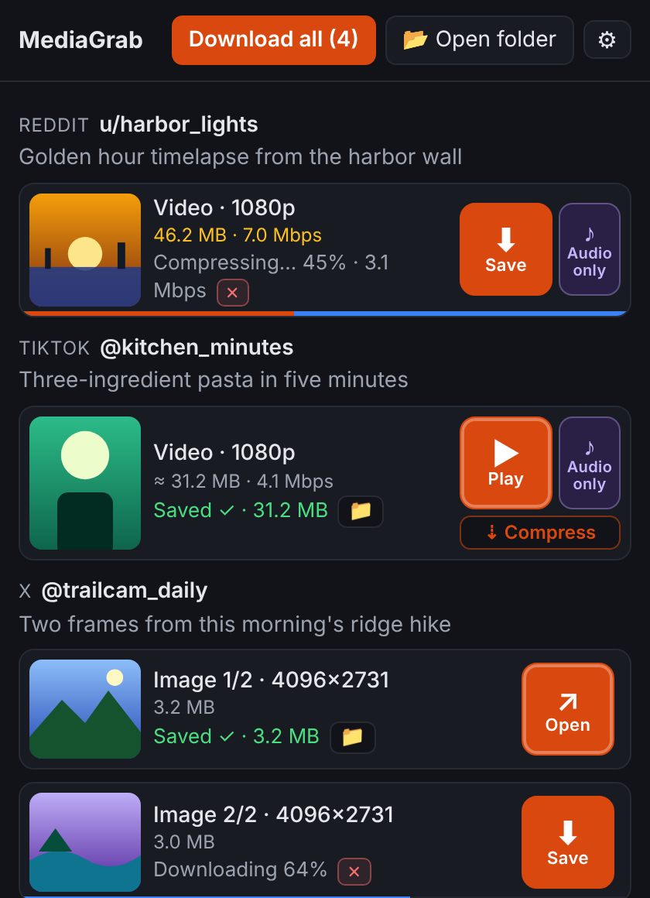
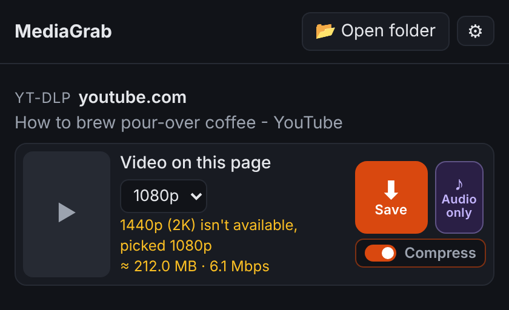
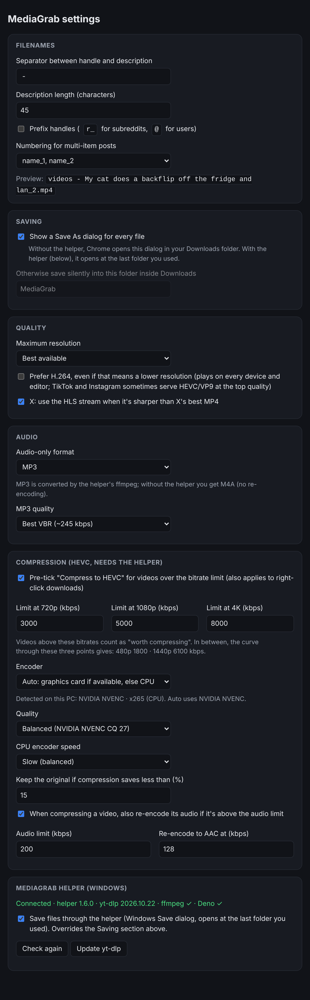

<p align="center">
  
</p>

<h1 align="center">MediaGrab</h1>

<p align="center">
  A Chrome extension that downloads videos, images and audio from <b>Reddit, X, Instagram, TikTok and Facebook</b> at the best quality available, with sound.<br>
  An optional Windows helper adds <b>yt-dlp</b> for YouTube and ~1,800 other sites, <b>MP3</b> audio, and a Save dialog that remembers your folder.
</p>

<p align="center">
  
  &nbsp;
  
</p>

## Features

- **Full quality, with sound.** Reddit and Instagram serve video and audio as separate streams. MediaGrab downloads the best of each and merges them locally into one MP4, copying the streams without re-encoding.
- **Toolbar popup** lists the media in the post you're viewing (or the posts on screen in a feed): a big **Save** button per item, **Audio** for videos, and **Download all**.
- **Right-click** any post → *Download media from this post* / *Download audio from this post*.
- **Galleries and carousels**: every image and video in a post, numbered.
- **Audio only** as MP3 (converted by the helper's ffmpeg) or M4A (the original track, no re-encoding).
- **Size before you save**: MediaGrab asks the server for each file's exact size (nothing is downloaded) and shows it with the video bitrate. Where a server won't tell, it falls back to an estimate from the site's own data ("≈"). The line turns orange when a video is over your bitrate limit.
- **Save + compress to HEVC** (helper): a per-video *Compress to HEVC* toggle, pre-ticked for videos over your limit (by default 3000 kbps at 720p, 5000 at 1080p and 8000 at 4K; other resolutions follow a curve through those three). Uses your graphics card (NVENC / Quick Sync / AMF, slowest and most efficient preset) or x265 on the CPU, and copies the audio untouched. Thirteen quality steps from near-lossless to tiny (named presets plus every step in between), shown with the exact value for your encoder. When a video is compressed, audio above 200 kbps is re-encoded to 128 kbps AAC. Shows progress and the current bitrate while it works (a thin bar under each item: blue for downloading, then orange sweeping over it for compression), and saves the result as `name_comp.mp4`. If the projected saving drops below your minimum (15% by default), it stops early and keeps the original. Changed your mind after saving? A saved video gets a **Compress** button. A red **✕** cancels any running download or compression (cancelling a compression keeps the original). Everything is adjustable in Settings.
- **After saving**: Save turns into **▶ Play** for the saved (or compressed) file, and 📁 shows it in its folder. **📂 Open folder** jumps to your last save.
- **Filenames** like `timelapse - Golden hour timelapse from the harbor wal.mp4` (subreddit or author, then the first 45 characters of the description), adjustable in Settings.
- **Quality settings**: maximum resolution, prefer H.264, use X's sharper HLS stream.
- **No tracking, no servers.** Everything runs in your browser (and on your PC, with the helper). The extension talks only to the sites you download from.

| Site | What it gets | Notes |
|---|---|---|
| Reddit | Best video + best audio from `v.redd.it`, merged | Galleries, GIFs, images, crossposts, and Redgifs / Imgur / Streamable links |
| X | Highest-bitrate MP4, or the HLS stream when it's sharper | Photos at original size |
| Instagram | DASH video + audio when sharper than the progressive MP4 | Posts, reels, carousels, stories |
| TikTok | Highest-resolution stream, no watermark | Photo posts too |
| Facebook | DASH video + audio, or HD progressive | Reels, video and photo pages, single posts (not feeds) |
| Anything else | yt-dlp (helper) | YouTube and ~1,800 other sites, with a quality picker |

## Install

1. Download this repository (**Code → Download ZIP**) and unzip it somewhere permanent.
2. Open `chrome://extensions` and turn on **Developer mode** (top right).
3. Click **Load unpacked** and select the folder.
4. Pin it: click the 🧩 puzzle icon in the toolbar, then the pin next to MediaGrab.
5. Reload any Reddit / X / Instagram / TikTok / Facebook tabs that were already open.

### Optional: MediaGrab Helper (Windows)

Chrome extensions can't run programs, and Chrome always opens an extension's Save As dialog in your Downloads folder. The helper is a small PowerShell program that Chrome is allowed to launch. It adds:

- the **Windows Save dialog opening at the last folder you used** (any drive). "Download all" asks once and saves the rest next to the first file;
- **yt-dlp** for YouTube and every site MediaGrab doesn't handle itself, with a **quality picker** that lists the video's real qualities, remembers your choice, and falls back to the highest one below it;
- **MP3** audio (ffmpeg conversion);
- **HEVC compression** of large videos after saving (ffmpeg).

To install it, double-click `helper\install.bat`. It needs no admin rights, winget or PATH changes. It:

- copies the helper to `%LOCALAPPDATA%\MediaGrab`;
- downloads `yt-dlp.exe`, ffmpeg and Deno (which yt-dlp needs for YouTube) from their official GitHub releases (~200 MB);
- registers the helper with Chrome (one per-user registry key).

Then open MediaGrab's settings (⚙ in the popup) and click **Check again**. It should say *Connected*. Run `install.bat` again any time to update the helper; **Update yt-dlp** in Settings updates yt-dlp. `helper\uninstall.bat` removes everything. The last compression's ffmpeg output is kept in `%LOCALAPPDATA%\MediaGrab\last-compress.log` for troubleshooting.

The extension has a fixed ID (`akdihefcbbgbeokfllakmflnelonapfa`, set by the public `key` in `manifest.json`), so the helper keeps recognising it wherever the folder lives.

## Settings



## How it works

```
popup / right-click ──► content script (per site) ──► reads the post's media from the
                         page's own data / site API      (+ captured API responses)
        │
        ▼
service worker ──► offscreen document: fetch → DASH / HLS → mp4mux.js (remux, no re-encode)
        │
        └──► Chrome downloads   or   MediaGrab Helper (native messaging):
                                       Save dialog · yt-dlp · ffmpeg (MP3)
```

| Path | What it is |
|---|---|
| `content/*.js` | One extractor per site. Most fixes after a site change land here. |
| `inject/hook.js` | Runs in the page and copies the site's own API responses (read-only) so media URLs are known without extra requests. |
| `lib/mp4mux.js` | Small ISO-BMFF remuxer: merges separate video/audio (fragmented or regular MP4) into one faststart MP4, or extracts the audio as M4A. |
| `lib/dash.js`, `lib/hls.js`, `lib/pick.js` | Stream manifest parsing and quality selection. |
| `offscreen.js` | Fetching, merging, and handing finished files back. |
| `background.js` | Service worker: popup/context-menu routing, jobs, saving. |
| `helper/` | Windows native messaging host (PowerShell) and its installer. |

## Known limits

- **X:** age-restricted or protected posts only work once the page has loaded them while you're logged in. The HLS upgrade needs fMP4 segments; MPEG-TS streams fall back to the best MP4.
- **Instagram:** highlights aren't handled. Posts not yet loaded on the page need you to be logged in.
- **TikTok:** picking the "current" video on the For You feed is best-effort. Open the video itself if the popup doesn't find it.
- **Facebook:** media is matched from page data. If nothing is found, reload the post page (or play the video once).
- **Imgur albums** and DASH manifests that use segment templates aren't supported.
- **Chrome's download list:** files saved through the helper don't appear in it, because Chrome only lists downloads it performed itself.
- **The helper is Windows-only.**

These sites change their markup and APIs often. When one breaks, the fix is usually confined to its file in `content/`.

## Responsible use

Download only content you have the right to save: your own uploads, content licensed for reuse, or personal offline viewing where that's permitted. Respect creators and each site's terms of service. MediaGrab doesn't bypass DRM or paywalls.

## License

[GPL-3.0](LICENSE). yt-dlp, ffmpeg and Deno aren't included in this repository. The helper installer downloads them from their official releases, under their own licenses.
